<p align="center">
  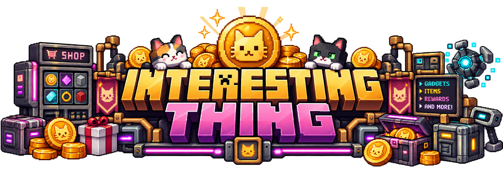
</p>

<h1 align="center">GT-Interesting-Thing</h1>
<p align="center"><strong><em>GTNH 趣味道具模组</em></strong><br><strong><em>GTNH Interesting Gadgets Mod</em></strong></p>

<p align="center">
  <a href="LICENSE"></a>
  
  
  <a href="https://github.com/GTNewHorizons/GT-New-Horizons-Modpack"></a>
  
</p>

此版本客户端与服务端均必须安装前置库 [MIAOKATZE Core 0.1.27+](https://github.com/MIAOKATZE/MIAOKATZE-Core)（最低版本：0.1.27）。FalsePatternLib 可在缺失时补下载；已有旧版请手动更新。

Both client and server require [MIAOKATZE Core 0.1.27 or newer](https://github.com/MIAOKATZE/MIAOKATZE-Core).

当前 2.x 系列仅支持 GTNH 2.9.0 RC-1 / RC-2；beta 和 2.8.4 玩家请按下表选择历史 Release。自 v2.0.0 起，建议 GTIT、GTSWN、GTSR 三者一起更新。

A GregTech New Horizons gadget mod that **provides interesting items enhancing the gameplay experience**, including flight cores, ore scanning tools, functional rings, a starter gift system, a hardcore reincarnation cycle, and a custom trading machine, while balancing usage costs to maintain progression integrity.

一个 GregTech New Horizons 趣味道具模组，**提供增强游玩体验的有趣物品**，包括浮空核心、探矿工具、功能性戒指、新手宝箱系统、周目轮回系统，以及自定义交易机器，同时平衡使用代价以保持进阶完整性。

> \[!NOTE]
> This is an unofficial mod. Please avoid discussing this mod in official GTNH forums.
> 这是一个非官方模组，讨论此模组时请注意场合。

## Downloads & Requirements / 下载与版本需求

下表按已发布 Release 的兼容声明列出各 GTNH 版本可下载的最新版本；历史版本不代表仍在维护。

The table lists the latest published release for each GTNH version, according to its release notes. Historical versions are no longer maintained.

| GTNH | GTIT Release / 下载 | Maintenance / 维护 |
| --- | --- | --- |
| 2.9.0 RC-1 / RC-2 | **[v2.0.8](https://github.com/MIAOKATZE/GT-Interesting-Thing/releases/tag/v2.0.8)** | 2.x 当前维护 / Active series |
| 2.9.0 beta-3 | [v1.9.3](https://github.com/MIAOKATZE/GT-Interesting-Thing/releases/tag/v1.9.3) | 历史版本 / Legacy |
| 2.9.0 beta-2 | [v1.9.3](https://github.com/MIAOKATZE/GT-Interesting-Thing/releases/tag/v1.9.3) | 历史版本 / Legacy |
| 2.9.0 beta-1 | [v1.9.3](https://github.com/MIAOKATZE/GT-Interesting-Thing/releases/tag/v1.9.3) | 历史版本 / Legacy |
| 2.8.4 | [v0.1.1](https://github.com/MIAOKATZE/GT-Interesting-Thing/releases/tag/v0.1.1) | 历史版本 / Legacy |

当前源码为 v2.0.20，对应 GTNH 2.9.0 RC-1 / RC-2；该版本目前为待发布草稿。表内下载版本以公开 Release 为准。v1.9.3 的 Release 同时声明支持 RC-1 / RC-2，保留在 1.x 系列的玩家也可使用。

Current source: v2.0.20 for GTNH 2.9.0 RC-1 / RC-2, currently an unpublished draft. The download table uses published releases. The v1.9.3 release also supports RC-1 / RC-2 for players staying on 1.x.

从对应 Release 下载运行包，并按该版本的说明安装前置；历史版本不要套用本文顶部的当前前置要求。2.8.4 的 v0.1.1 Release 中，运行包实际文件名为 `gtit-0.1.0.jar`。

Download the runtime JAR and follow the dependency requirements of the selected release; the current requirements above do not apply to historical versions. The runtime asset in the v0.1.1 release for 2.8.4 is named `gtit-0.1.0.jar`.

***

## Neko Vending Machine / 猫猫售货机

<p align="center">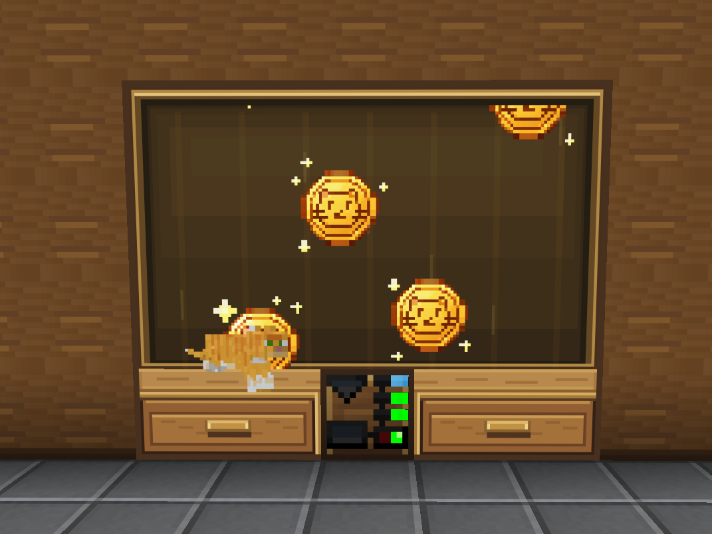<br><em>用户实拍：猫咪与金币动画 / User screenshot: cats and animated coins</em></p>

以下为用户提供的游戏实拍。图内物品数量、价格、冷却和启用内容以拍摄存档为准。

The images below are user-provided in-game screenshots. Item counts, prices, cooldowns and enabled content reflect the capture save.

A custom trading machine — since V2 an independently implemented multiblock built on GT5U's `MTEEnhancedMultiBlockBase` (the early prototype originated from the VendingMachine mod) — featuring an independent currency system (Neko Coin), dynamic tabbed GUI, BetterQuesting integration, and BGM. Designed as a progression-gated reward shop where players earn Neko Coins through quests and spend them on loot bags and items.

自定义交易机器——V2 起为基于 GT5U `MTEEnhancedMultiBlockBase` 独立实现的多方块机器（开发早期原型源自 VendingMachine 模组），拥有独立的货币系统（猫猫币）、动态标签页 GUI、BetterQuesting 任务集成和背景音乐。设计为进度门控奖励商店——玩家通过任务获取猫猫币，再消费猫猫币购买战利品袋和物品。

### Structure & ME Connection / 结构与 ME 接入

<p align="center">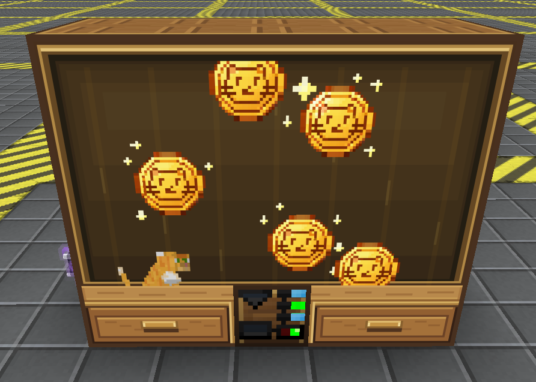</p>

The machine is **5 blocks wide × 4 high × 2 deep**, with the controller at the bottom center of the front face and **39 dedicated Neko casings**. Any one casing position may be replaced by a dedicated Neko ME uplink hatch; at most one hatch is allowed. Convert one original Vending Machine Casing or ME Vending Uplink Hatch into its dedicated Neko counterpart with a **one-way, 1:1 shapeless recipe**.

结构为**宽 5 × 高 4 × 深 2**，控制器位于正面底边中央，其余为 **39 个猫猫售货机专用机械方块**。任意机械方块位置可替换为猫猫专用 ME 上行链路仓，整机最多 1 个。原 VendingMachine 机械方块与 ME 上行链路仓分别通过**单向 1:1 无序合成**转换为对应猫猫专用部件。

<p align="center">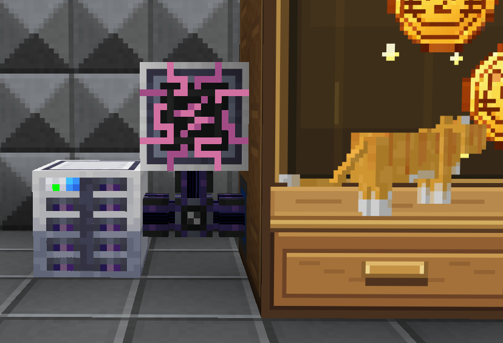<br><em>ME 网络接入示意 / ME network connection example</em></p>

Connect the dedicated hatch to an available AE network to use ME input and output controls in the machine interface.

将专用仓接入可用的 AE 网络后，可在机器界面使用 ME 输入与输出控制。

### Currency System / 货币系统

Two types of Neko Coins, stored in an independent wallet system (not in player inventory):

两种猫猫币，存储在独立钱包系统中（不占用玩家背包）：

| Currency / 货币                | ID               | Description / 说明                                   |
| ---------------------------- | ---------------- | -------------------------------------------------- |
| Neko Coin / 猫猫币              | `neko`           | Basic currency, earned through BQ quest completion |
| Shimmering Neko Coin / 闪烁猫猫币 | `shimmeringNeko` | Premium currency, earned through harder quests     |

- **Team wallet / 团队钱包**: Wallets are shared among team members via GTNHLib Teams API. All members of the same team share a single wallet balance. (Since v1.5.1; v1.5.0 used per-player personal wallets stored in `<world>/gtit_neko_wallets/<uuid>.dat`)
- Neko Coins are automatically detected when placed in the trade edit inventory
- Coins are deducted natively from the wallet by V2's own trade executor (`NekoWallet.tryDeduct`, atomic), no Mixin involved
- **Cooldown scaling / 冷却缩放**: The number of trades allowed within each cooldown scales with team membership (at least one)
- **团队钱包**：钱包通过 GTNHLib Teams API 在团队成员间共享，同团队的所有成员共享同一个钱包余额。（自 v1.5.1 起；v1.5.0 使用按玩家个人钱包，存储在 `<world>/gtit_neko_wallets/<uuid>.dat`）
- 在交易编辑界面放入猫猫币时自动识别为货币参数
- 猫猫币由 V2 自身交易执行器从钱包原生扣减（`NekoWallet.tryDeduct`，原子操作），不经由 Mixin
- **冷却缩放**：每轮冷却内的交易次数上限按团队成员数计算，至少一次

<p align="center">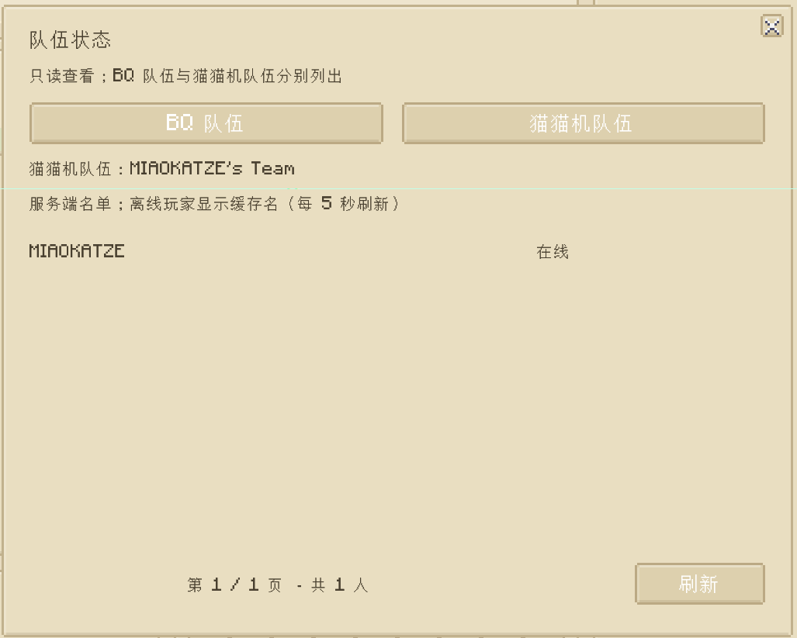</p>

Use the team button to inspect the BQ team and Neko machine team separately. This read-only panel lists server-reported members and their online status; it does not change team membership.

点击队伍按钮可分别查看 BQ 队伍与猫猫机队伍。面板只读显示服务端成员名单及在线状态，不修改队伍归属。

### Trade System / 交易系统

Three trade types supported:

支持三种交易类型：

| Type / 类型             | Example / 示例                               |
| --------------------- | ------------------------------------------ |
| Pure Neko Coin / 纯猫猫币 | 100 Neko Coins → 1 Loot Bag                |
| Mixed / 混合交易          | 50 Neko Coins + 10 Iron Ingots → 1 Diamond |
| Item Exchange / 物品交换  | 10 Iron Ingots → 1 Diamond (no coins)      |

**Trade entry fields / 交易条目字段**:

- `tabId`: Which tab the trade appears in
- `orderId`: Sort order within the tab
- `currency`: Legacy Neko Coin cost field; current V2 trades store coin requirements in `fromItems`
- `fromItems`: Required items, including Neko Coins and alternative or ore-dictionary choices
- `toItems`: Reward items
- `cooldown`: Cooldown in seconds (0 = no cooldown)
- `bqQuestId`: BQ quest requirement (empty = no requirement)

### Alternative & Ore Dictionary Matching / 多重匹配与矿词匹配

<p align="center">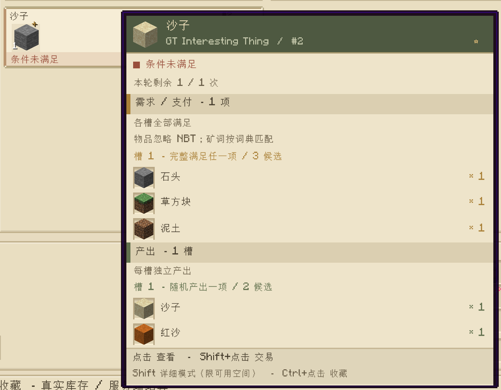<br><em>自定义示例：完整满足一个候选，每个产出槽随机一项 / Custom example: fulfill one alternative, then draw one reward per output slot</em></p>

In edit mode, **Alt + left-click** enables adding alternatives to either a requirement or a reward slot. Each choice keeps its own amount: a requirement can be “8 iron ingots or 4 copper ingots,” and each transaction must fully satisfy one choice. **Middle-click** opens the ore dictionary dialog; enter a custom ore name and a fixed amount. Items sharing that ore name can jointly satisfy the requirement, while the slot item serves as its icon and initial ore suggestion.

编辑模式下，**Alt + 左键**开启格子的多重叠加，再放入物品即可追加选项；需求格与产出格均可使用。每个选项保留自己的数量，例如“铁锭 ×8 或铜锭 ×4”，每笔交易完整满足其中一项。**中键**打开矿词弹框，可输入自定义矿词和固定数量；同矿词的不同物品可以凑足需求，格内物品仅作为图标和初始矿词提示。空白格悬停也会显示操作说明。

Each reward slot independently chooses one alternative per transaction. An ore dictionary reward then randomly selects one registered item for that ore name. The screenshot is a custom example: **1 stone, grass block or dirt** yields **1 sand or red sand** at random. It is not a bundled recipe. Default trades retain exact item matching.

每笔交易中，每个产出格随机选择一个选项；矿词产出再随机选择该矿词注册的一种物品。图中为自定义示例：“石头、草方块、泥土各 ×1”任选一项，换取“沙子、红沙各 ×1”中的随机一项，并非内置配方。默认交易仍采用精确物品匹配。

### GUI & Tabs / 界面与标签页

<p align="center">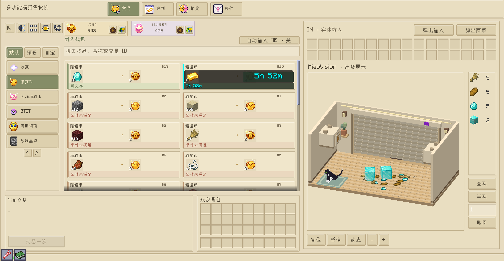<br><em>交易界面 / Trade GUI</em></p>

- **Dynamic tabs / 动态标签页**: Separate default, preset and custom trade views; adding, deleting or editing a tab updates the open GUI without reopening it
- **Neko Coin display / 猫猫币显示**: Real-time balance display with expandable details
- **Coin intercept slot / 猫猫币拦截槽**: Automatically routes Neko Coins from inventory to wallet
- **Sort & Search / 排序与搜索**: Sort by order ID or name, with text search filtering
- **BGM / 背景音乐**: 3 random BGM variants with 2-second fade in/out, max 50% volume
- **BQ lock display / BQ 锁定显示**: Locked trades show golden "LOCKED" text with cooldown overlay; cooling-down trades show cyan cooldown text
- **动态标签页**：默认、预设与自定义贸易分栏显示；新增、删除或编辑后同步更新打开中的 GUI，无需关闭重开
- **猫猫币显示**：实时余额显示，可展开详情
- **猫猫币拦截槽**：自动将背包中的猫猫币导入钱包
- **排序与搜索**：按顺序 ID 或名称排序，支持文字搜索过滤
- **背景音乐**：3 首随机 BGM，2 秒淡入淡出，最大音量 50%
- **BQ 锁定显示**：锁定交易显示金色 "LOCKED" 文字 + 冷却遮罩；冷却中交易显示青色冷却时间

猫猫贸易现已接入 NEI：对物品按 R / U 查询产出与用途，对售货机按 U 浏览贸易；配方显示兑换间隔，关联任务可点击打开任务书。

Neko trades are available in NEI: use R / U on items to find outputs and uses, or U on the vending machine to browse trades. Recipes show trade intervals and clickable linked quests.

### MiaoVision Output / MiaoVision 出货展示

<p align="center">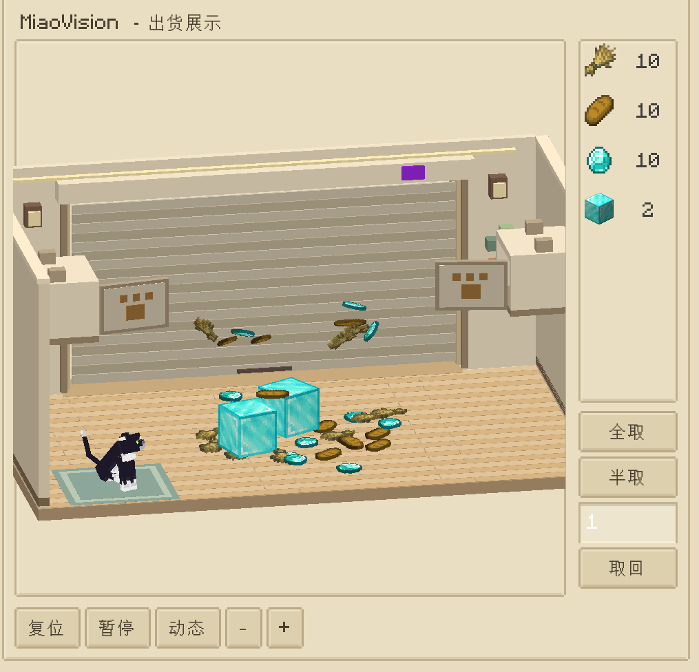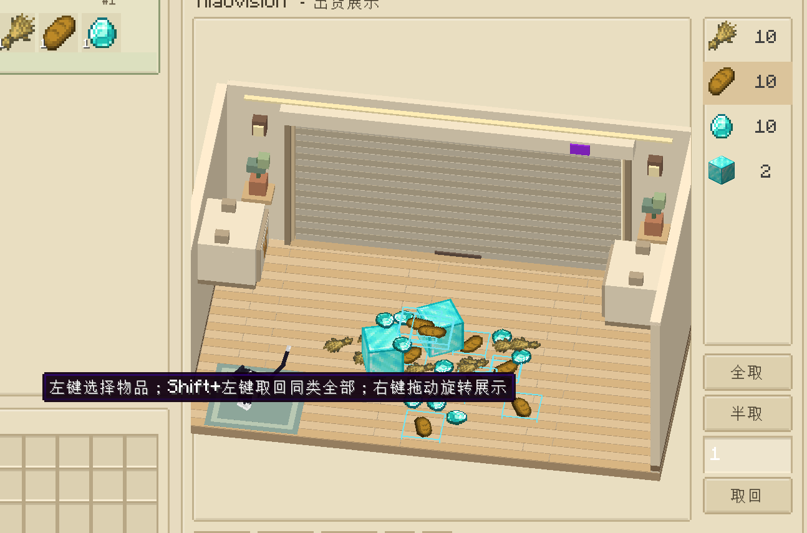</p>

MiaoVision presents delivered items in a small animated room. Left-click an item to select it, Shift + left-click to retrieve all matching items, and right-drag to rotate the view. The side list provides all, half and exact-amount retrieval; the bottom controls reset the view, pause the presentation and adjust its scale.

MiaoVision 将产出展示为带动画的小房间。左键选择物品，Shift + 左键取回同类全部，右键拖动旋转视角；侧栏支持全取、半取与指定数量取回，底部可复位视角、暂停展示及调整缩放。

<p align="center">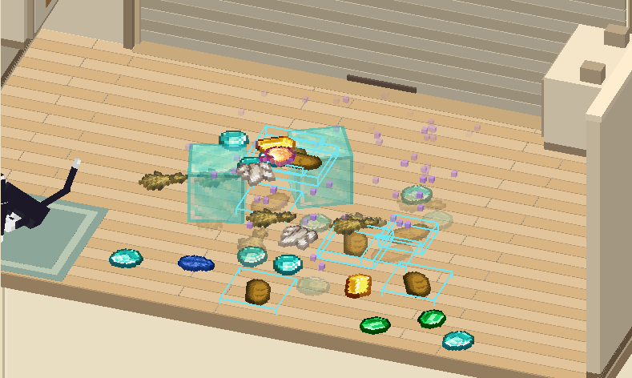<br><em>ME 上传效果 / ME transfer effects</em></p>

With a connected ME uplink, enable ME output to send newly produced items to the network. MiaoVision shows the transfer effect while the server handles the actual inventory transfer.

接入 ME 上行链路仓后，开启 ME 输出可将新产出送入网络；MiaoVision 显示上传特效，实际库存转移由服务端处理。

### Default Trade Presets / 默认贸易预设

<p align="center">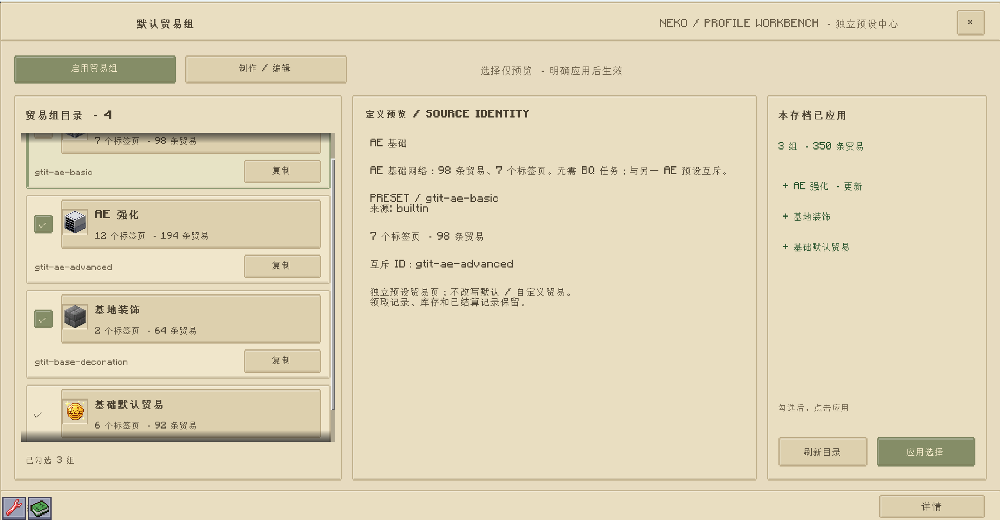<br><em>贸易组预设 / Trade presets</em></p>

Use `/gtit presets` to browse the jar-provided default groups and apply your selection; management requires the single-player owner or a server administrator (default OP2, configurable OP2–4). Default, preset and custom trades have separate columns.

使用 `/gtit presets` 浏览 JAR 内置默认贸易组并应用所选组；管理操作要求单人存档拥有者或服务器管理员（默认 OP2，可配置 OP2–4）。默认、预设与自定义贸易分栏显示。

<p align="center">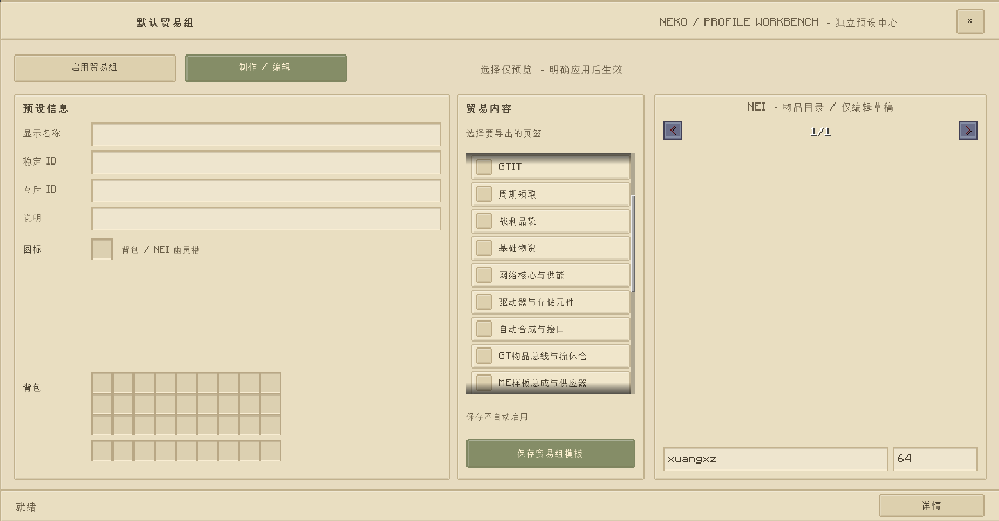</p>

The editor saves selected pages as a named preset with a stable ID, icon and optional exclusion ID. Saving a new preset does not enable it automatically: select it in the catalog and apply the selection.

编辑器可将选中页签保存为带名称、稳定 ID、图标及可选互斥 ID 的预设。新预设保存后不会自动启用，需返回目录勾选并应用。

AE presets use three cooldown tiers: basic 0, advanced 2 hours, and high tier 8 hours; the same product keeps the same tier across presets. Batch requirements and outputs scale together, with larger cable batches; tools and one-time entries retain their per-entry rules. Creative Energy Controllers remain one-time trades.

AE 预设采用基础 0、进阶 2 小时、高阶 8 小时三档冷却；同商品跨预设使用同一档位。批次需求与产出同比放大，线缆采用较大批量；工具及一次性条目保留各自规则。创造能量控制器仍为一次性交易。

图内所选组和数值来自用户存档；默认批量、价格与冷却以当前版本随包数据为准。 / The selected groups and values shown come from the user's save; consult the current bundled data for default batches, prices and cooldowns.

### BetterQuesting Integration / BQ 任务集成

Trades can be locked behind BQ quest completion:

交易可绑定 BQ 任务作为前置条件：

- **Server-side lock / 服务端锁定**: `NekoBqCondition` (a V2 trade condition) checks BQ quest completion before the trade executes
- **Client-side display / 客户端显示**: `NekoTradeDisplayWidgetV2` shows golden "LOCKED" overlay for locked trades
- **Event sync / 事件同步**: `NekoBqBridge` listens for quest completion events and maintains a completion cache
- **Sort optimization / 排序优化**: Locked trades are sorted after available trades (cooldown does not affect sort order)
- **bqQuestId formats / bqQuestId 格式**: Supports base64 (recommended, from BQ quest filename), `high:low`, and standard UUID
- **服务端锁定**：`NekoBqCondition`（V2 交易条件）在交易执行前检查 BQ 任务完成状态
- **客户端显示**：`NekoTradeDisplayWidgetV2` 为锁定交易显示金色 "LOCKED" 遮罩
- **事件同步**：`NekoBqBridge` 监听任务完成事件并维护完成状态缓存
- **排序优化**：锁定交易排在可交易之后（冷却不影响排序）
- **bqQuestId 格式**：支持 base64（推荐，从 BQ 任务文件名复制）、`high:low`、标准 UUID

### Visual Editor / 可视化编辑

Enable with `/gtit nekovm edit on` (see [Administrator Commands](#administrator-commands--管理员命令)), then click trade entries in the machine GUI to edit them visually. The editing surface covers seven domains: trades, tab pages, lottery entries, lottery pools, sign-in rewards, online-time tiers, and blessings.

通过 `/gtit nekovm edit on` 开启（见[管理员命令](#administrator-commands--管理员命令)），在售货机 GUI 内点击交易条目即可进行可视化编辑。编辑面现覆盖七个域：交易条目、标签页、抽奖条目、抽奖卡池、签到奖励、在线时长档位与祝福。

<p align="center">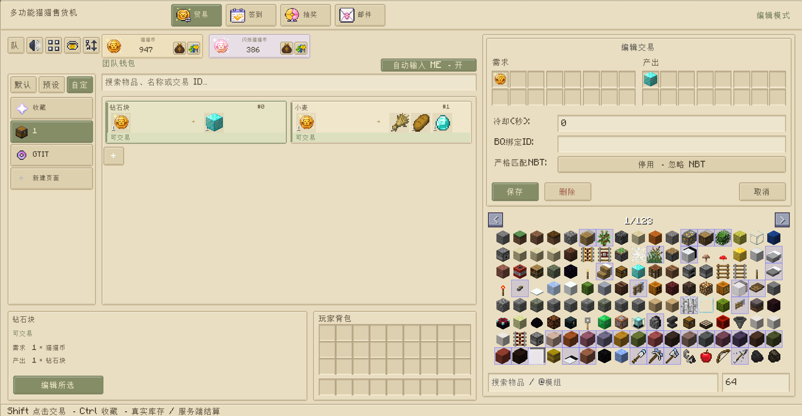</p>

Copy items from your inventory or the embedded NEI catalog into ghost slots to configure requirements and rewards without consuming or spawning items.

从背包或嵌入的原生 NEI 目录复制物品到幽灵槽，即可配置需求与产出；不消耗源物品，也不生成物品。


### Configuration / 配置

| File / 文件              | Path / 路径                                | Description / 说明                                                            |
| --------------------- | --------------------------------------- | -------------------------------------------------------------------------- |
| Trades / 交易配置         | `config/gtit/trade/trades/tab_<id>.json` | Trade entries with tabId, orderId, items (optionally with `nbtBase64`), currency, cooldown, bqQuestId |
| Tabs / 标签页配置          | `config/gtit/trade/pages.json`          | Custom tab definitions (ID, name, icon)                                     |
| Trade ledger / 贸易整合记账 | `config/gtit/trade/integrated/`         | Version ledger for integrated trade groups (delete a file to force re-registration) |
| Lottery pools / 抽奖卡池   | `config/gtit/lottery/lottery.json`      | Gacha pool definitions (pools with entries, cost items, pity config)        |
| Lottery ledger / 抽奖整合记账 | `config/gtit/lottery/integrated/`       | Version ledger for integrated lottery pool groups                           |
| Wallets / 钱包          | GTNHLib Teams team data                 | Team-shared Neko Coin balances (v1.5.0: per-player `<world>/gtit_neko_wallets/<uuid>.dat`) |
| Gifts / 礼包定义           | `config/gtit/gifts.json`                | Gift definitions and rewards; old `gift_config.json` is read only during the first migration / 礼包定义与奖励；旧 `gift_config.json` 仅首次迁移读取 |

If no trade config exists, default trades are generated from built-in defaults on first launch; with `enhancedDefaultTrades` enabled, the bundled base trade group from jar assets takes over instead.

如果交易配置不存在，首次启动时将生成默认交易；开启增强默认交易（`enhancedDefaultTrades`）时，由 jar 内置基础贸易组替代内置默认交易。

### Third-party Integration API / 第三方整合 API

Register external trade groups and lottery pool groups from your own mod via three interchangeable channels, all funnelling into the same idempotent, version-ledgered pipeline:

- **Java direct call / Java 直调**: `NekoTradeIntegrationAPI.registerTradeGroup(NekoTradeGroupDef)` / `LotteryIntegrationAPI.registerLotteryPool(LotteryPoolGroupDef)` — thread-safe, queued until the server is ready.
- **IMC**: `FMLInterModComms.sendMessage("gtit", "gtit:registerTradeGroup" | "gtit:registerTradeAsset" | "gtit:registerLotteryPool", nbt)` with the definition JSON in the NBT string field (`groupJson` / `tradeAssetJson`).
- **jar assets / jar 资产清单（BQ 式）**: ship `assets/<your-modid>/gtit/trade/index.json` + `groups/*.json` and `assets/<your-modid>/gtit/lottery/index.json` + `pools/*.json` inside your jar (an explicit manifest — jar directories are not enumerable on 1.7.10), then call `NekoTradeIntegrationAPI.registerTradeAssetsFromJar("<your-modid>")` / `LotteryIntegrationAPI.registerLotteryPoolsFromJar("<your-modid>")` in `postInit`.

Minimal example / 最小示例：

```java
// postInit（物品注册完成后）
NekoTradeIntegrationAPI.registerTradeAssetsFromJar("mymod");
LotteryIntegrationAPI.registerLotteryPoolsFromJar("mymod");

// 或程序化直调（def JSON 模型见 NekoTradeGroupDef / LotteryPoolGroupDef）
NekoTradeIntegrationAPI.registerTradeGroup(def);
LotteryIntegrationAPI.registerLotteryPool(poolGroupDef);
```

Idempotence & version ledger / 幂等与版本记账：each group is recorded in `config/gtit/trade/integrated/<groupId>.json` or `config/gtit/lottery/integrated/<groupId>.json` with its source version. Same version → skipped (player edits to `tab_*.json` / `lottery.json` stay authoritative); version bump → old content is removed per the ledger and re-registered; deleting the ledger file forces re-registration. Pools/trades owned by the player's local config are never silently overwritten (WARN + skip on conflict).

每个组在 `config/gtit/{trade,lottery}/integrated/<groupId>.json` 记账：版本未变跳过（玩家对 `tab_*.json` / `lottery.json` 的编辑保持权威）；版本变化按记账移除旧内容后重注册；删除记账文件即强制重注册；玩家本地配置占用的池/交易不会被静默覆盖（冲突 WARN 跳过）。

Full schema, ledger semantics walkthrough and the content-author workflow: local working notes `plan/wiki/integration-assets-api.md` (kept out of git per repo convention); durable entries in the MIAO GTNH wiki: `mods/gtit/integration/assets-api.md` and `mods/gtit/lottery/lottery-draw-algorithm.md`.

完整 schema、版本记账语义图解与内容作者工作流见本地工作树文档 `plan/wiki/integration-assets-api.md`（按仓库惯例不入库）；持久版本见 MIAO GTNH wiki 条目 `mods/gtit/integration/assets-api.md` 与 `mods/gtit/lottery/lottery-draw-algorithm.md`。


### Mixin Architecture / Mixin 架构

Since V2, trade logic (currency deduction, BQ locks, cooldowns) is handled natively by the mod's own machine and trade-executor classes instead of Mixins. The remaining Mixins cover rings, neko BGM, fishing coins, reincarnation ascension, and compatibility:

自 V2 起交易逻辑（货币扣减、BQ 锁定、冷却）由模组自身的机器与交易执行类原生处理，不再经由 Mixin。现存 Mixin 覆盖戒指、猫猫 BGM、钓鱼猫猫币、周目升天与兼容性：

| Mixin                              | Target                                     | Function / 功能                                             |
| ---------------------------------- | ------------------------------------------ | ----------------------------------------------------------- |
| `MixinPlayerControllerMP`           | `PlayerControllerMP.getBlockReachDistance` | Client-side block reach extension for Ring of Distant Grasp |
| `MixinItemInWorldManager`           | `ItemInWorldManager.getBlockReachDistance` | Server-side block reach extension for Ring of Distant Grasp |
| `NekoSoundManagerMixin`             | `SoundManager.playSound`                   | Capture neko BGM sound source for per-frame volume control  |
| `MixinAEBaseGuiDrawHoveringTextFix` | `GuiScreen.drawHoveringText`               | Fix AE2 tooltip `AbstractMethodError` under Angelica         |
| `MixinEntityFishHook`               | `EntityFishHook` fish-catching roll        | Server-side bonus Neko Coin / Shimmering Neko Coin on each successful player catch (default 10% / 2%, config-tunable; machine fish farms get nothing — anti-farm) / 玩家每次成功钓鱼服务端掷概率附赠猫猫币/闪烁猫猫币（默认 10%/2%，Config 可调；机器渔场不产，防刷币） |
| `MixinEntityRenderer`               | `EntityRenderer.setupCameraTransform`      | Reincarnation ascension camera warp (read-only replica of vanilla portal dizziness, hard-gated to the 120t cutscene window) / 周目升天相机 warp（只读复刻原版传送门眩晕，120t 演出窗口硬门控） |

Sound-mute Mixins are listed in the [Machine Sound Mute](#machine-sound-mute--机器音效静音) section.

机器音效静音相关 Mixin 见[机器音效静音](#machine-sound-mute--机器音效静音)章节。

***

## Daily Sign-In / 每日签到

<p align="center">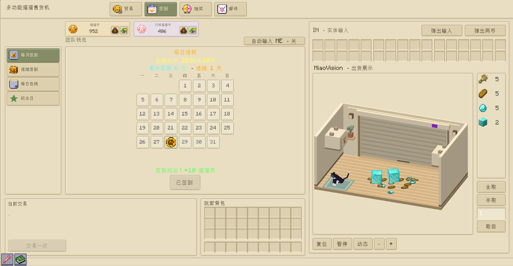<br><em>签到界面 / Sign-In GUI</em></p>

A daily reward system that grants players cumulative rewards for logging in each day, with optional online-time tier bonuses.

每日签到系统，玩家每日登录可领取累积奖励，并支持按在线时长解锁额外档位奖励。

***

## Lottery / 抽奖

<p align="center">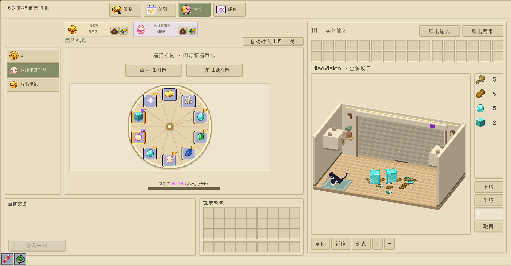<br><em>抽奖界面 / Lottery GUI</em></p>

A gacha-style reward pool where players spend Neko Coins or items to draw random rewards.

消耗猫猫币或物品进行随机抽奖的奖励池系统。

<p align="center">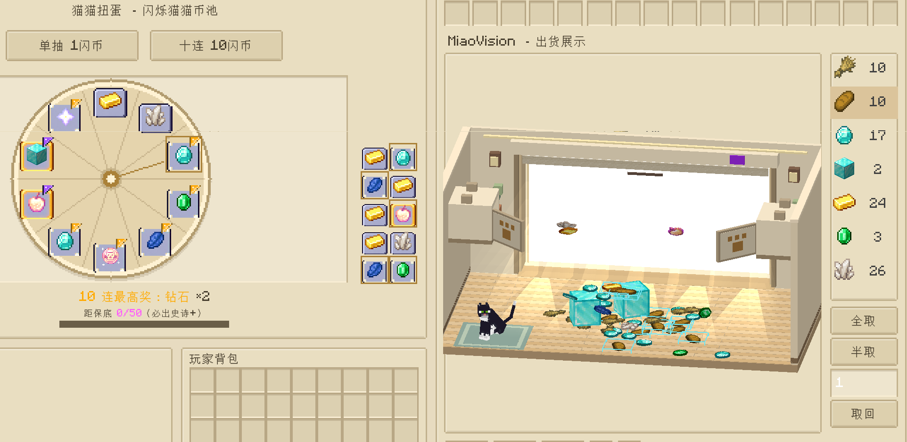</p>

***

## Mail / 邮件

<p align="center">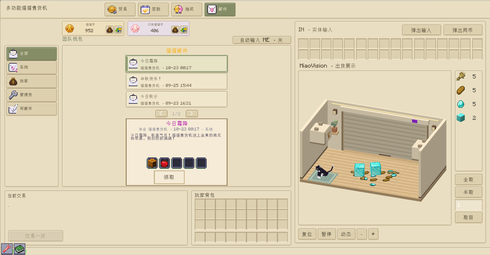<br><em>邮件界面 / Mail GUI</em></p>

An in-game mail system for receiving rewards, announcements, and attachments from server operators or automated events.

游戏内邮件系统，用于接收管理员或自动事件发放的奖励、公告与附件。

***

## Items / 物品

### Float Core / 浮空核心

<p align="center"><br><em>浮空核心 / Float Core</em></p>

A simple yet powerful flight enabler. Equip to any Baubles slot to gain creative-like flight ability.

简单而强大的飞行道具。装备到任意 Baubles 饰品栏即可获得类似创造模式的飞行能力。

- Equip to any Baubles slot to gain flight
- Consumes hunger per tick while flying
- Automatically disables flight when hunger drops below 3 shanks (6 hunger points)
- Early-game accessible — no electricity required
- 装备到任意 Baubles 饰品栏即获得飞行能力
- 飞行时每 tick 消耗饥饿值
- 饥饿值低于3格（6点）时自动禁用飞行
- 前期即可获取——无需电力

***

### Electric Float Core / 电力浮空核心

<p align="center"><br><em>电力浮空核心 / Electric Float Core</em></p>

An upgraded version of the Float Core with massive EU storage. When electricity runs out, it falls back to hunger consumption at half the rate.

浮空核心的升级版，拥有超大 EU 容量。电力耗尽时回退至饥饿消耗，消耗量为浮空核心的一半。

- LV voltage tier, 32,000,000 EU capacity
- Consumes electricity while flying
- Falls back to hunger consumption when depleted (half rate of Float Core)
- Compatible with IC2 charging stations
- LV 电压等级，32,000,000 EU 容量
- 飞行时消耗电力
- 电力耗尽时消耗饥饿值（浮空核心的一半消耗率）
- 兼容 IC2 充电站

***

### Telekinesis Ore Scanner Core / 念力共振探矿核心

<p align="center"><br><em>念力共振探矿核心 / Telekinesis Ore Scanner Core</em></p>

A long-range ore and fluid prospecting tool that integrates with JourneyMap via VisualProspecting. Scan results are uploaded to the map automatically — you cannot view ore info directly, preserving the exploration challenge.

远程矿石和流体勘探工具，通过 VisualProspecting 与旅行地图集成。扫描结果自动上传至地图——无法直接获取矿石信息，保留探索挑战性。

- Right-click air or block to scan a 19×19 chunk area
- Consumes 6 hunger points per scan
- Data automatically uploaded to JourneyMap (requires VisualProspecting)
- Cannot view ore info directly — only map markers
- Shift + Right-click to switch between Ore / Fluid detection mode
- Requires VisualProspecting mod for map integration
- 右击空气或方块进行 19×19 区块大范围探矿
- 每次消耗 6 点饥饿值进行探矿
- 数据自动上传至旅行地图（需要 VisualProspecting）
- 无法直接获取矿石信息——仅显示地图标记
- Shift + 右键切换矿石/流体探测模式
- 需要 VisualProspecting 模组实现地图联动

***

### Infinity Cell / 无限存储元件

<p align="center"><br><em>猫猫无限存储单元 / Neko Infinity Storage Unit（动画材质首帧）</em></p>

<p align="center"><br><em>[OLD] 移植版两枚 / the two AE2Things-derived legacy cells (still usable, deprecated)</em></p>

GTIT 自有的**多通道**无限容量存储元件：同一枚元件在同一个驱动器槽位里同时向物品、流体以及整合包已注册的第三方通道（源质等）贡献无限容量，各通道内容独立分桶存放。数据外部化存储在全局 WorldSavedData 中，避免 NBT 膨胀。从 AE2Things 移植来的物品版与流体版已降级为 `[OLD]`，仍可正常使用。

An AE2 storage cell of GTIT's own design: **one cell serves every registered channel** — items, fluids and, when the pack registers one, essentia — all from a single drive slot, each kept in its own bucket. Data is externalized to a global WorldSavedData, avoiding NBT bloat. The AE2Things-derived item and fluid cells are now `[OLD]` but still work.

- **Channels / 通道**: 物品 + 流体 + 运行时已注册的第三方通道（源质等）/ items, fluids and any registered third-party type (e.g. essentia)
- **Capacity / 容量**: 每通道 Integer.MAX\_VALUE 种类型、每类型 1 字节，实际无限
- **Idle drain / 空闲功耗**: 1 AE/tick（多通道只计一次）
- **Upgrade slots / 升级卡槽**: 2（物品通道支持分区、模糊、分类卡）
- **Migration / 迁移**: 两枚 `[OLD]` 旧元件（物品版 + 流体版）可在工作台**无序合成**为 1 枚新单元（不比较 NBT），迁移前请先用 ME-IO 端口转空存量；旧元件每 10 分钟向归属玩家播报所在容器坐标以提示迁移

### Neko Dimensional Pocket / 猫猫次元口袋

<p align="center"><br><em>猫猫次元口袋：三栏独立滚动 / three independently scrollable storage columns</em></p>

一枚缝着猫脸的束口袋。猫猫们从不解释针脚里藏着什么——只知道你右键时它会打个大大的哈欠，把库存、液体与源质都吞进梦境般柔软的某处；它似乎永远装不满，也从不肯把吃进去的东西弄丢。

A drawstring pouch with a cat face sewn on. The cats never explain what's stitched inside — only that it yawns wide when you right-click, swallowing your inventory, fluids and essentia into somewhere soft as a dream. It never seems to fill up, and it never loses what it has swallowed.

- **Storage / 存储**: 更紧凑的面板，三个存储区域可独立滚动、拖动滚动条；30 个流体槽、207 个物品槽、120 个源质格。/ A compact panel with three independent, draggable scrollbars: 30 fluid slots, 207 item slots and 120 essentia slots.
- **STACK / 堆叠插件**: 最多安装 64 枚，第一枚将可堆叠物品的单格上限提升到 1,024，之后每枚再增加 1,024，最高 65,536；数量达到 1,000 时以一位小数的 k 显示。超过 64 后仍可手持同类物品左键补入、右键补入一件。/ Up to 64 modules provide 1,024 items per module, reaching 65,536 per eligible slot. Counts of 1,000 or more use one decimal place with `k`; matching carried items can still be added to stacks above 64.
- **CAPACITY / 容量插件**: 最多安装 64 枚，流体槽基础容量 20M mB，前 63 枚各增加 30M，第 64 枚增加 90M，最终每槽 2G mB；旧容量插件保留原有 2G。/ Up to 64 modules raise each fluid slot from 20M mB to 2G mB; modules 1–63 add 30M each and the final module adds 90M. Existing capacity upgrades retain their 2G capacity.
- **Channel toggle / 通道开关**: 通道插件新装默认关闭，可在猫猫币栏旁便携开关次元通道。/ Newly installed channel modules start disabled; toggle the persistent dimension channel beside the Neko Coin area.
- **Upgrade modules / 升级插件**: 插件放入即固化、不可取出；除堆叠和容量插件可累计外，其余各安装一枚。五种插件拥有动态物品图标，并支持磁力拾取、蒸馏加速等功能。/ Modules are permanent once installed. STACK and CAPACITY modules accumulate; the other modules are limited to one each. All five have animated item icons, with functions including magnetic pickup and faster distillation.
- **Recipe / 配方**: `PEP / LCL / LLL`（末影珍珠 + 末影之眼 + 皮革 + 猫猫无限存储单元，不比较元件 NBT）；前置 ModularUI2、AE2、GT5U，Thaumcraft 4 可选。

***

## GTMB 联动 / GTMB Integration

安装 GTMB 后，可在猫猫售货机中用 1 枚普通猫猫币兑换 GTMB 猫猫投影仪。投影仪由 GTMB 提供。

When GTMB is installed, the Neko Vending Machine exchanges one ordinary Neko Coin for one GTMB projector. The projector is provided by GTMB.

***

## Rings / 戒指

<p align="center">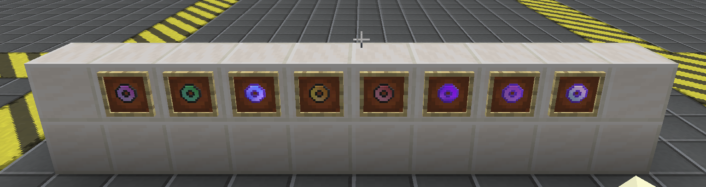<br><em>8 枚功能性戒指 / 8 Functional Rings</em></p>

A set of 8 functional rings that equip to Baubles ring slots, providing various buffs and abilities. Rings are obtained from chest loot, crafting, or the starter gift.

8 枚功能性戒指，装备于 Baubles 戒指栏，提供各种增益和能力。戒指可通过宝箱战利品、合成或新手宝箱获得。

### Baubles Ring Slot Expansion / Baubles 戒指栏扩展

The mod expands the Baubles ring slots from **2 to 10** via the Baubles-Expanded API, allowing the player to equip multiple rings simultaneously and stack effects.

模组通过 Baubles-Expanded API 将戒指栏从 **2 个扩展到 10 个**，使玩家可以同时装备多枚戒指并叠加效果。

- Calls `BaubleExpandedSlots.tryAssignSlotsUpToMinimum("ring", 10)` during PreInit
- Falls back to `overrideSlots()` during Init to ensure correct slot ordering
- Automatically compatible with other mods using `BaublesApi.getBaubles()` (dynamic `getSizeInventory()`)
- 在 PreInit 阶段调用 `BaubleExpandedSlots.tryAssignSlotsUpToMinimum("ring", 10)`
- 在 Init 阶段通过 `overrideSlots()` 兜底，确保槽位顺序正确
- 自动兼容其他使用 `BaublesApi.getBaubles()` 遍历的模组（动态 `getSizeInventory()`）

### Ring List / 戒指总览

| # | Name / 名称                       | Effect / 效果                                                                                | Stackable / 叠加 |
| - | ------------------------------- | ------------------------------------------------------------------------------------------ | :------------: |
| 1 | Ring of Distant Grasp / 戒指·遥握   | Interaction & attack range +2 per ring / 交互与攻击距离 +2                                        |       ✔️       |
| 2 | Ring of Skywalk / 戒指·凌步         | Auto step-up 1 block / 自动走上 1 格方块                                                          |       ✖️       |
| 3 | Ring of Windrider / 戒指·御风       | Creative flight / 创造飞行                                                                     |       ✖️       |
| 4 | Ring of Gluttony / 戒指·饕餮        | Continuous hunger restore + emergency fill / 持续恢复饥饿度 + 应急饱食                                |       ✖️       |
| 5 | Ring of Ironheart / 戒指·磐躯       | Max health +20 per ring (10 hearts) / 生命上限 +20                                             |       ✔️       |
| 6 | Ring of Dragon's Breath / 戒指·龙息 | Fire Resistance + Night Vision + Regeneration I + Resistance I / 抗火 + 夜视 + 生命恢复 I + 抗性提升 I |       ✖️       |
| 7 | Ring of Mountainbreaker / 戒指·裂山 | Strength II + Haste II / 力量 II + 急迫 II                                                     |       ✖️       |
| 8 | Ring of Tempest / 戒指·疾风         | Speed II + Jump Boost II / 速度 II + 跳跃提升 II                                                 |       ✖️       |

### Ring Details / 戒指详情

- **Ring of Distant Grasp / 戒指·遥握**: Extends block reach distance via Mixin (`MixinPlayerControllerMP`). Each ring adds +2 blocks. Stackable — multiple rings compound the bonus.
- **Ring of Skywalk / 戒指·凌步**: Automatically steps up 1-block heights without jumping. Walks smoothly like flat ground.
- **Ring of Windrider / 戒指·御风**: Grants creative flight with no cost. Obtained only via crafting.
- **Ring of Gluttony / 戒指·饕餮**: Restores 1 hunger/sec; restores saturation when full. Emergency-fills hunger and saturation when below 5 (60s cooldown).
- **Ring of Ironheart / 戒指·磐躯**: Uses `SharedMonsterAttributes.maxHealth` Attribute Modifier. Each ring adds +20 max health (10 hearts). Stackable.
- **Ring of Dragon's Breath / 戒指·龙息**: Refreshes 30s potion effects every 5s — no flickering.
- **Ring of Mountainbreaker / 戒指·裂山**: Refreshes 30s potion effects every 5s.
- **Ring of Tempest / 戒指·疾风**: Refreshes 30s potion effects every 5s.
- **戒指·遥握**：通过 Mixin（`MixinPlayerControllerMP`）扩展方块交互距离，每枚 +2 格，可叠加。
- **戒指·凌步**：自动走上 1 格高方块，如履平地，无需跳跃。
- **戒指·御风**：获得创造飞行，无消耗。仅通过合成获得。
- **戒指·饕餮**：每秒恢复 1 点饥饿值，满后恢复饱和度；饥饿度低于 5 时一次性补满（冷却 60 秒）。
- **戒指·磐躯**：使用 `SharedMonsterAttributes.maxHealth` 属性修饰器，每枚 +20 生命上限（10 颗心），可叠加。
- **戒指·龙息**：每 5 秒刷新 30 秒药水效果。
- **戒指·裂山**：每 5 秒刷新 30 秒药水效果。
- **戒指·疾风**：每 5 秒刷新 30 秒药水效果。

***

## Starter Gift / 新手宝箱

<p align="center">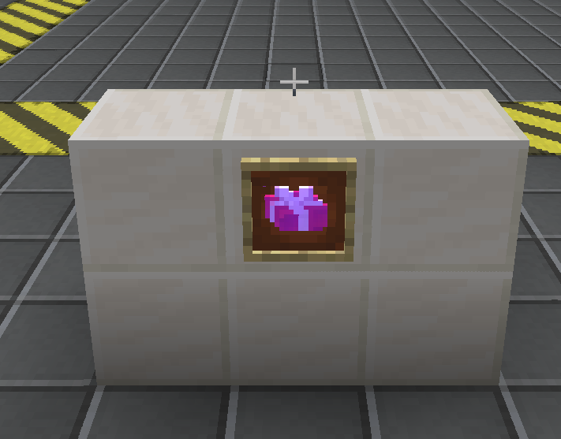<br><em>新手宝箱 / Starter Gift</em></p>

A gift box automatically granted to players on their **first login** to a world. Right-click to open and receive a set of starter items — guaranteed items plus randomly drawn items from a configurable pool.

玩家**首次进入某个世界**时自动获得的新手宝箱。右击打开即可获得一系列新手物资——包含必中物品和从随机物品池中抽取的随机物品。

- Auto-granted on first world login (tracked via persisted NBT)
- Right-click to open: grants guaranteed items + random items
- Items drop to the ground if inventory is full
- Configure current gifts through `/gifts`; definitions are saved to `config/gtit/gifts.json`
- Default random pool includes 6 rings (Skywalk, Gluttony, Ironheart, Dragon's Breath, Mountainbreaker, Tempest)
- 首次进入世界自动发放（通过持久化 NBT 追踪）
- 右击打开：获得必中物品 + 随机物品
- 背包满了物品丢到地上
- 使用 `/gifts` 管理当前礼包；定义保存在 `config/gtit/gifts.json`
- 默认随机池包含 6 枚戒指（凌步、饕餮、磐躯、龙息、裂山、疾风）

### Gift Center / 礼包中心

<p align="center">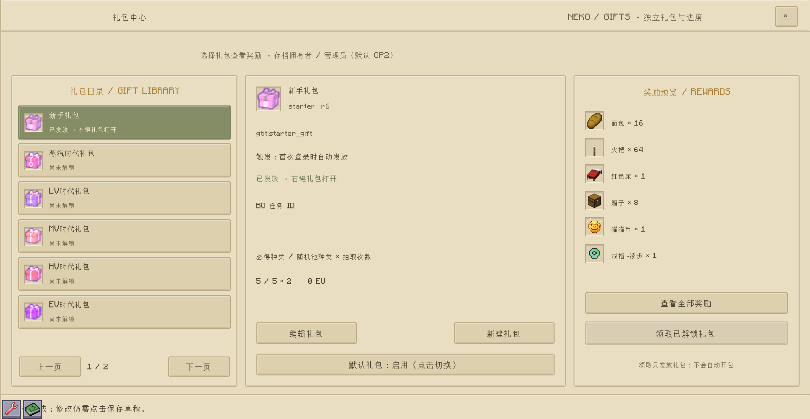<br><em>礼包中心 / Gift Center</em></p>

Use `/gifts` to view gift rewards, unlock conditions and claim status. The single-player owner or a server administrator (default OP2, configurable OP2–4) can create and edit gifts in the management interface.

使用 `/gifts` 查看礼包奖励、解锁条件与领取状态；单人存档拥有者或服务器管理员（默认 OP2，可配置 OP2–4）可在管理界面新建和编辑礼包。

<p align="center">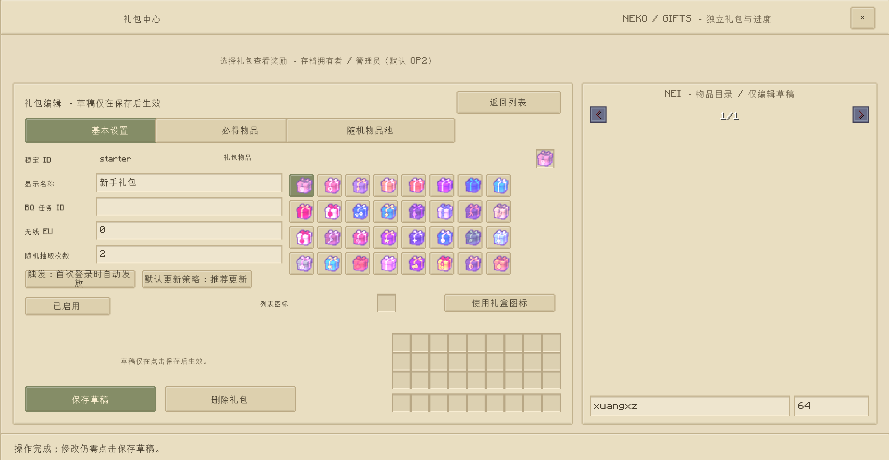</p>

Edit the basic settings, guaranteed rewards and random pool on separate tabs, then save the draft to apply changes. / 基本设置、必得物品与随机物品池分栏编辑，保存草稿后修改才生效。

### Legacy Gift Config / 旧宝箱配置

`config/gtit/gift_config.json` is read during the first migration. Current definitions use `config/gtit/gifts.json`; edit rewards and item NBT in the `/gifts` management interface. The legacy format below remains supported for migration. / 首次迁移会读取 `config/gtit/gift_config.json`；之后以 `config/gtit/gifts.json` 为准，奖励及物品 NBT 使用 `/gifts` 管理界面编辑。以下旧格式保留迁移兼容。

```json
{
  "guaranteed_items": [
    { "item": "minecraft:bread", "amount": 16, "meta": 0 },
    { "item": "minecraft:torch", "amount": 64, "meta": 0 }
  ],
  "random_items": [
    { "item": "gtit:ring_skywalk", "amount": 1, "meta": 0 },
    { "item": "minecraft:enchanted_book", "amount": 1, "meta": 0, "nbtBase64": "..." }
  ],
  "random_count": 2
}
```

- `guaranteed_items`: Items always granted / 必中物品
- `random_items`: Random item pool / 随机物品池
- `random_count`: Number of random items drawn / 随机抽取数量
- `nbtBase64` (optional): Base64-encoded NBT data in the legacy format / 可选，旧格式中的 Base64 编码 NBT 数据

***

## Reincarnation / 周目轮回

<p align="center">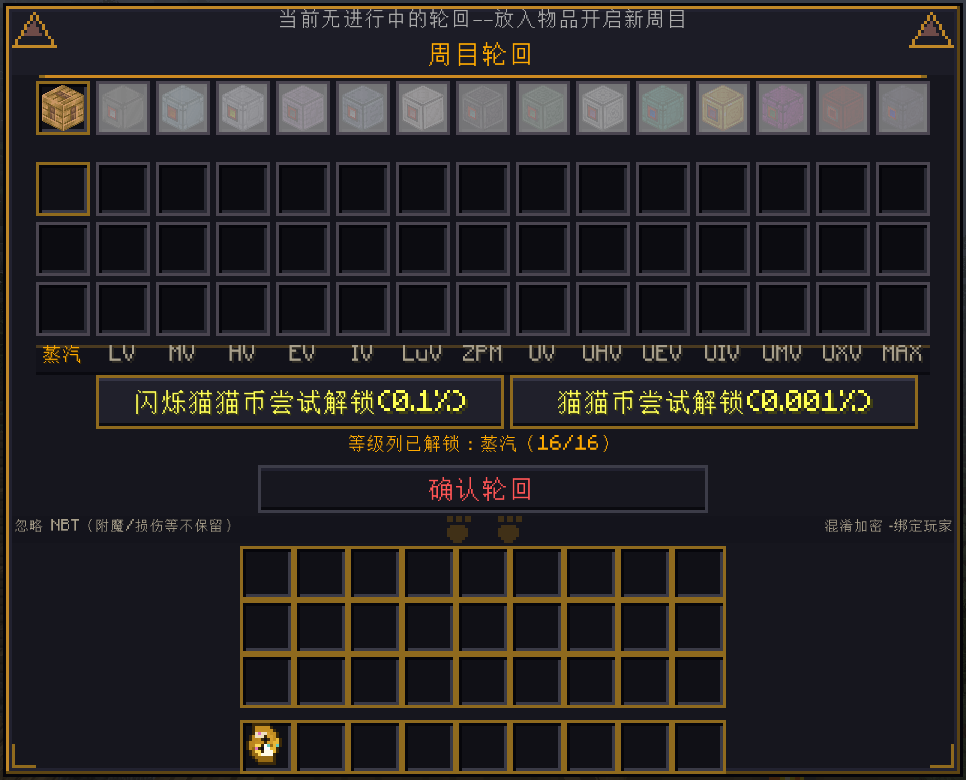<br><em>周目轮回 GUI / Reincarnation GUI</em></p>

A hardcore "new cycle" system built around the Reincarnation Crystal. Deposit items, confirm reincarnation, and your character ascends and dies — the world save is deleted — while the deposited items carry over to the next world as a reincarnation reward. Strictly single-player: the whole system disables itself when the world is shared over LAN.

围绕轮回水晶构建的硬核"新周目"系统。寄存物品、确认轮回后角色升天死亡——存档随之删除——寄存的物品则作为轮回奖励穿越到下一个世界。仅限严格单机：对局域网开放时周目系统整体停用。

### Cycle Flow / 轮回流程

- Right-click a **Reincarnation Crystal** to open the Reincarnation GUI / 右击**轮回水晶**打开周目 GUI
- Deposit items, then press **Confirm Reincarnation**: a 6-second ascension plays, the character dies, and the world save is deleted / 寄存物品后按下**确认轮回**：6 秒升天演出后角色死亡，存档删除
- Re-entering a world whose timeline has already been reincarnated triggers a 30-second countdown before the same ascension / 进入已被轮回过的时间线时，30 秒倒计时结束后同样升天
- Deposited items travel through the reincarnation mailbox and are granted **5 seconds** after the first login to the new world / 寄存物品经投胎信箱穿越，在新世界首次登录 **5 秒**后发放
- Reward items spiral down **one by one** — each becomes pickupable in the final 15% of its descent (~0.4 blocks away); excess drops to the ground when the inventory is full / 奖励物品**依次**螺旋降落——每件在降落末段 15%（距玩家约 0.4 格）即可拾取；背包满则掉落地面
- Spark trail particles stop in the final 20% of each item's descent to keep the view clear / 每件物品降落的最后 20% 停撒拖尾粒子，避免遮挡视野
- Enchantments and damage NBT are not preserved (the deposit ignores NBT) / 附魔、损伤等 NBT 不保留（寄存忽略 NBT）
- Cycle data is obfuscated, encrypted and bound to the player / 周目数据混淆加密、绑定玩家

### Progression / 进度解锁

- **15 hull columns** (Steam → MAX): feed machine hulls into a column's slot — 16 hulls unlock the column / **15 个等级列**（蒸汽 → MAX）：向列槽放入机器外壳，累计 16 个解锁该列
- **3 unlockable rows** via Neko Coin rolls: press an unlock button to toggle continuous rolling (1 coin per tick while active); Shimmer Neko Coin has a 0.1% and Neko Coin a 0.001% success rate per roll / **3 行解锁**靠猫猫币连掷：按下解锁按钮开始连掷（激活期间每 tick 消耗 1 枚），闪烁猫猫币单掷 0.1%、猫猫币单掷 0.001% 成功率
- Unlocked rows and columns determine the deposit slots available for the next cycle / 已解锁的行与列决定下次轮回可用的寄存格

***

## Machine Sound Mute / 机器音效静音

Two QoL configs controlling GT5U machine sounds. Config file: `config/gtit/gtit_mute.json`.

两项 GT5U 机器音效静音配置。配置文件：`config/gtit/gtit_mute.json`。

```json
{
  "_comment_mute": "mute_machine_working_sounds=true 时：新放置机器默认静音（有 GUI 按钮的机器可单独取消静音）。",
  "mute_machine_working_sounds": false,
  "_comment_extra_mute": "extra_mute=true 时：额外强制拦截无静音按钮机器的音效（锅炉蒸汽排放音/锅炉沸腾加热循环音/管道蒸汽泄漏音），不受 GUI 按钮控制。",
  "extra_mute": false
}
```

### `mute_machine_working_sounds`

- **`false` (default)**: No intervention. Players can toggle each machine's mute button in its GUI.
- **`true`**: Newly placed machines (or those without a saved mute state) default to muted; players can still unmute per-machine via the GUI button.
- **`false`（默认）**：不干预，玩家可通过每台机器 GUI 右上角的静音按钮单独控制。
- **`true`**：新放置或未保存过静音状态的机器默认静音；玩家仍可通过 GUI 按钮单独取消。

### `extra_mute`

For machines **without** a GUI mute button (boilers, fluid pipes). Force-cancels their sounds regardless of any state.

针对**没有** GUI 静音按钮的机器（锅炉、流体管道）。无论状态如何，强制拦截其音效。

- **`false` (default)**: No intervention.
- **`true`**: Force-cancel boiler steam-vent sound (`ventSteamIfTankIsFull` → `sendSound`), boiler boiling/heating loop sounds, and fluid pipe steam-leak sound.
- **`false`（默认）**：不干预。
- **`true`**：强制拦截锅炉蒸汽满罐排放音（`ventSteamIfTankIsFull` → `sendSound`）、锅炉沸腾/加热循环音、流体管道蒸汽泄漏音。

### Mixin Architecture / Mixin 架构

| Mixin                              | Target                              | Config                | Function / 功能                                                                                |
| ---------------------------------- | ----------------------------------- | --------------------- | ---------------------------------------------------------------------------------------------- |
| `MixinBaseMetaTileEntityMuffle`    | `setInitialValuesAsNBT` (TAIL)      | `mute_machine_working_sounds` | Default new machines to `mMuffler=true`; GUI button still works per-machine                   |
| `MixinMTEBrickedBlastFurnace`      | `updateSound` (HEAD)                | `mute_machine_working_sounds` | Cancel brick blast furnace flame loop sound                                                    |
| `MixinMTEBlackHoleCompressor`      | `playBlackHoleSounds` (HEAD)        | `mute_machine_working_sounds` | Cancel black hole compressor loop sound                                                        |
| `MixinMTEBoilerVentSteam`          | `MTEBoiler.doSound` (HEAD)          | `extra_mute`          | Cancel boiler steam vent sound + particle (`SOUND_EVENT_LET_OFF_EXCESS_STEAM`)                 |
| `MixinMTEBoilerSoundLoops`         | `updateSoundLoops` (HEAD)           | `extra_mute`          | Cancel boiler boiling/heating loop sounds (`GTCEU_LOOP_BOILER` / `GTCEU_LOOP_FURNACE`)         |
| `MixinMTEFluidPipeSound`           | `MTEFluidPipe.doSound` (HEAD)       | `extra_mute`          | Cancel fluid pipe steam-leak sound (`aIndex==9`, `RANDOM_FIZZ`)                                |

***

## Multiblock Test Machine / 多方块测试机器

A development-stage test multiblock (HV tier, 3×3×3 hollow TungstenSteel) once used to verify the multiblock registration process, structure detection logic, and recipe system integration. It was removed in v1.6.30 — the Neko Vending Machine V2, built directly on GT5U's `MTEEnhancedMultiBlockBase`, has since taken over this role.

开发阶段用于验证多方块机器注册流程、结构检测逻辑及配方系统的测试多方块（HV 级，3×3×3 空心钨钢结构）。该测试机已于 v1.6.30 移除——直接基于 GT5U `MTEEnhancedMultiBlockBase` 构建的猫猫售货机 V2 已承接其职责。

***

## Administrator Commands / 管理员命令

Administrative `/gtit` commands require OP permission level 2. Gift and preset management require the single-player owner or a server administrator (default OP2, configurable OP2–4); default trade reset requires the owner or OP4. **Tab completion supports** working subcommands and online player names; there are no `trade tab` / `orderId` command branches. Inventory operations and NekoVM changes are player-only; module help is also available from the console. `/gifts` is a separate player command without an OP requirement.

管理指令 `/gtit` 保持 OP2 门槛；礼包与预设管理要求单人存档拥有者或服务器管理员（默认 OP2，可配置 OP2–4），默认贸易重置要求单人拥有者或 OP4。**Tab 补全**涵盖实际子命令和在线玩家名，没有 `trade tab` 或顺序 ID 命令。背包操作及 NekoVM 修改仅玩家可执行，各模块帮助也支持控制台。普通玩家使用独立的 `/gifts` 查看与领取礼包。

Use `/gtit help [module]` for syntax and `/gtit tutorial [module]` for guidance. Modules: `gift`, `nekovm`, `presets`, `signin`, `lottery`, `mail`. / 使用 `/gtit help [模块]` 查看语法，`/gtit tutorial [模块]` 查看步骤；模块包括上述六类。也支持 `/gtit <模块> help|tutorial`。

### Starter Gift / 新手宝箱

| Command / 指令                                | Description / 说明                                                               |
| ------------------------------------------- | ------------------------------------------------------------------------------ |
| `/gifts [ui|claim <ID>|help|tutorial]`    | Browse gifts; manual claims apply only to enabled BQ-unlock gifts / 查看礼包；手动领取仅适用于启用的 BQ 解锁型礼包 |
| `/gtit gift reset`                          | Reset to default config / 恢复默认配置                                                 |
| `/gtit gift claimlist`                      | List players who claimed the gift (online + offline) / 列出已领取玩家（在线+离线）          |
| `/gtit gift claimreset [all\|玩家名]`         | Reset claim status; re-gift on next login / 重置领取状态，玩家下次登录时自动发放（支持离线玩家） |

### NekoVM / 猫猫售货机

| Command / 指令                | Description / 说明                                                        |
| --------------------------- | ------------------------------------------------------------------------ |
| `/gtit nekovm edit on\|off` | Toggle visual config edit mode / 开关可视化配置编辑模式                              |
| `/gtit nekovm reload`       | Hot-reload trade + tab config / 热重载交易与标签页配置                                |
| `/gtit nekovm timereset`    | Reset the current player/team's trade history, counts and cooldowns / 重置当前玩家或团队的贸易历史、次数与冷却 |
| `/gtit nekovm defultreset`  | Force-restore default trade data; single-player owner / OP4 / 强制恢复默认贸易数据，需单人拥有者或 OP4 |
| `/gtit presets`             | Open trade preset management; owner / administrator (default OP2, configurable OP2–4) / 打开贸易预设管理，需单人拥有者或管理员（默认 OP2，可配 OP2–4） |
| `/gtit nekovm help`         | Full help / 完整帮助                                                              |

`defultreset` is the documented command spelling; `defaultreset` remains an accepted alias. It is separate from `timereset`, which resets player/team history. Custom pages and trades are created in the vending-machine editor after `/gtit nekovm edit on`, rather than through an unimplemented tab-creation command. / 教学使用用户指定拼写 `defultreset`，同时兼容 `defaultreset`；它与重置玩家/团队历史的 `timereset` 不同。自定义标签页和条目应在 `edit on` 后使用售货机内编辑入口创建。

### Sign-In / 每日签到

| Command / 指令                              | Description / 说明                                                        |
| ----------------------------------------- | ------------------------------------------------------------------------ |
| `/gtit signin`                            | Show sign-in command help; use the vending machine's sign-in page to sign in / 显示签到命令帮助；签到请使用售货机签到页面 |
| `/gtit signin info [玩家名]`                | View sign-in status (online players only) / 查看签到状态（目标仅支持在线玩家）        |
| `/gtit signin reload`                     | Hot-reload sign-in + online-time reward config / 热重载签到与在线时长奖励配置        |
| `/gtit signin admin set <玩家名> <天数>`     | Set consecutive sign-in days / 设置连续签到天数（在线玩家）                          |
| `/gtit signin admin reset <玩家名>`         | Reset a player's sign-in data / 重置玩家签到数据（在线玩家）                          |
| `/gtit signin help`                        | Full help / 完整帮助                                                              |

### Lottery / 抽奖

| Command / 指令           | Description / 说明                        |
| ---------------------- | ---------------------------------------- |
| `/gtit lottery reload` | Hot-reload lottery pool config / 热重载抽奖卡池配置 |
| `/gtit lottery help`   | Full help / 完整帮助                                 |

### Mail / 邮件

| Command / 指令                              | Description / 说明                                                                                       |
| ----------------------------------------- | ------------------------------------------------------------------------------------------------------ |
| `/gtit mail send <玩家名> <标题> [正文...]`   | Send mail; attachment = held item (console sends as "系统" without attachment) / 发送邮件；附件=执行者手持物品（控制台以「系统」名义发送、无附件） |
| `/gtit mail first <标题> [正文...]`           | Set first-login reward template, overwrites the old one / 设置首登奖励模板（覆盖旧模板；仅玩家）                  |
| `/gtit mail firstclear`                   | Clear the first-login reward template / 清除首登奖励模板                                                  |
| `/gtit mail once <奖励ID> <标题> [正文...]`    | Publish a one-time reward; every player receives it once / 发布一次性奖励，全体玩家各收一次（奖励 ID 不可重复）      |
| `/gtit mail help`                      | Full help / 完整帮助                                                                                      |

A literal `\n` in mail bodies is converted to a line break. / 邮件正文中字面 `\n` 会被转换为换行。

### Server Management Terminal / 服务器管理终端

| Command / 指令    | Description / 说明                                                                                     |
| ---------------- | ---------------------------------------------------------------------------------------------------- |
| `/gtit terminal` | Open the server management terminal (mail / sign-in / trade-cooldown / gift-audit panels); in-game OP2 players only — unavailable and unlisted on physical dedicated servers / 打开服务器管理终端（邮件/签到/交易冷却/礼包审计四页面板）；仅游戏内 OP2 玩家可用，物理专用服务器上不可用且 Tab 补全不提示 |

***

## Tech Stack / 技术栈

- Jabel (modern Java syntax, Java 8 bytecode) / Minecraft 1.7.10 / Forge 10.13.4.1614
- ModularUI / ModularUI2 / StructureLib
- Dependencies: MIAOKATZE Core 0.1.27+, GT5-Unofficial (5.09.54.205), GTNHLib, VisualProspecting, Baubles-Expanded, IC2; VendingMachine 0.4.100 (dev local jar; original casings and ME uplinks convert to GTIT's dedicated Neko parts), BetterQuesting 3.8.72 (compileOnly)
- Jabel（现代 Java 语法，编译为 Java 8 字节码）/ Minecraft 1.7.10 / Forge 10.13.4.1614
- 依赖：MIAOKATZE Core 0.1.27+、GT5-Unofficial（5.09.54.205）、GTNHLib、VisualProspecting、Baubles-Expanded、IC2；VendingMachine 0.4.100（dev 本地 jar；原机械方块与 ME 仓可转换为 GTIT 猫猫专用部件）、BetterQuesting 3.8.72（compileOnly）

***

## License / 许可证

Released under the AGPL-3.0 License. See the LICENSE file for details.

以 AGPL-3.0 许可证发布，详见 LICENSE 文件。

***

## Acknowledgments / 致谢

- **[AE2Things](https://github.com/asdflj/AE2Things)** — The Infinity Cell implementation is adapted from AE2Things' storage cell code (GTNH 2.8.4 version), rewritten for the GTNH 2.9.0 AE2 API.
  无限存储元件的最初实现移植自 AE2Things 的存储元件代码（GTNH 2.8.4 版本），为 GTNH 2.9.0 AE2 API 重写；v1.8.22 起已被 GTIT 自有的多通道「猫猫无限存储单元」取代，移植版两枚降级为 `[OLD]` 保留。
- **[VendingMachine](https://github.com/GTNewHorizons/VendingMachine)** — The Neko Vending Machine originated on top of the VendingMachine framework, with custom currency, GUI, and trade logic, before being rebuilt as the independent V2 multiblock on GT5U.
  猫猫售货机最初基于 VendingMachine 框架构建（自定义货币、界面与交易逻辑），后重构为基于 GT5U 的独立 V2 多方块机器。
